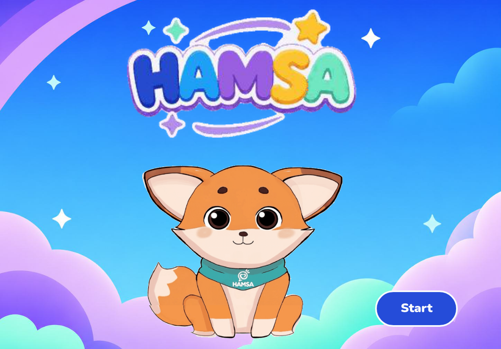
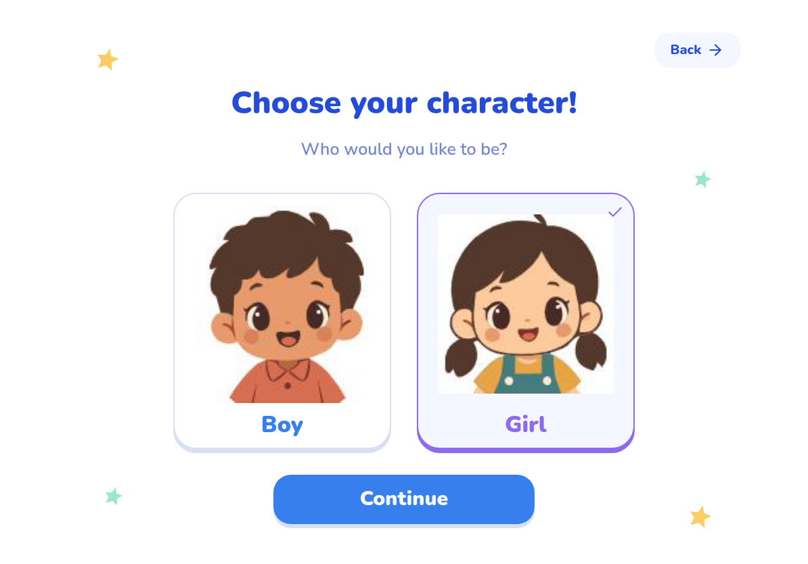
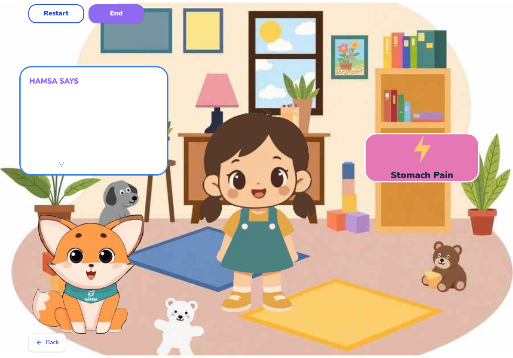
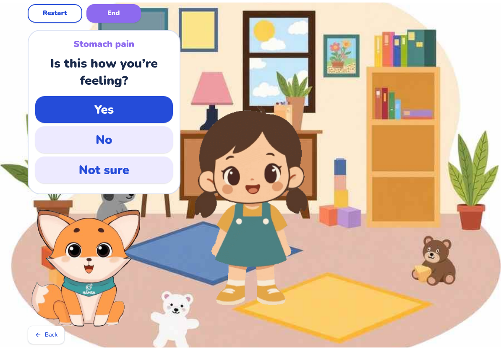
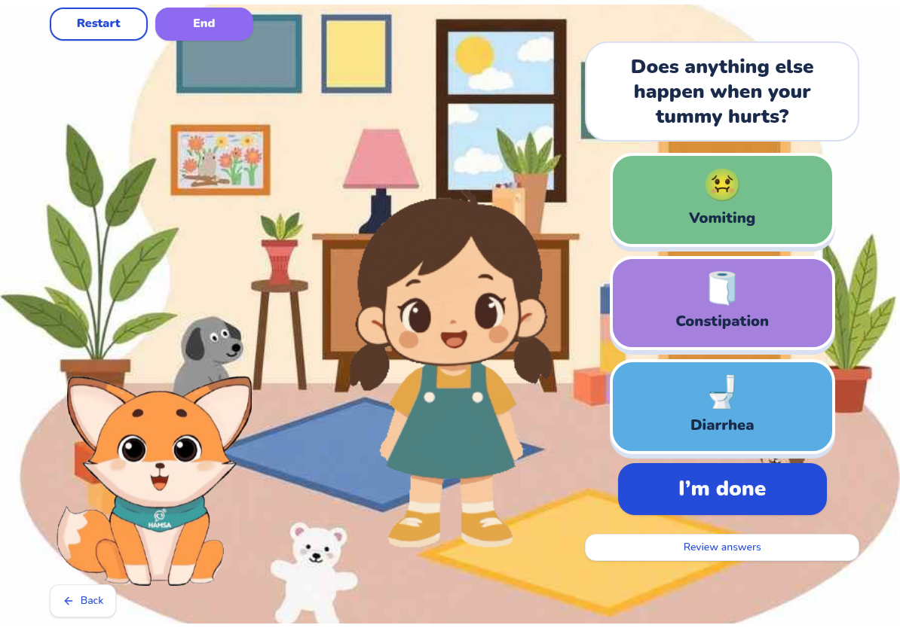
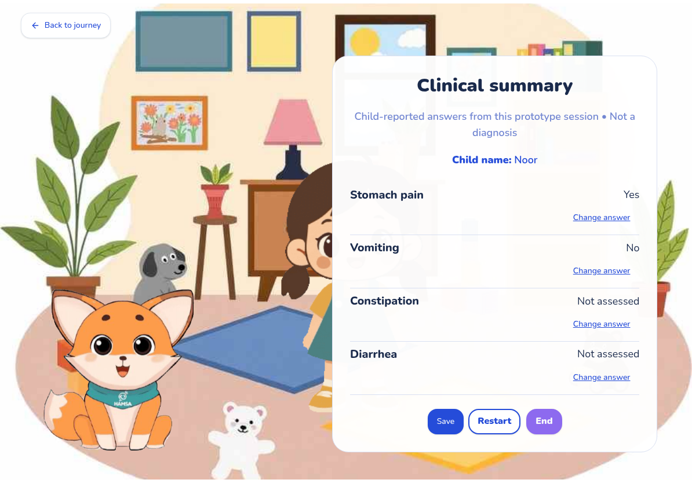
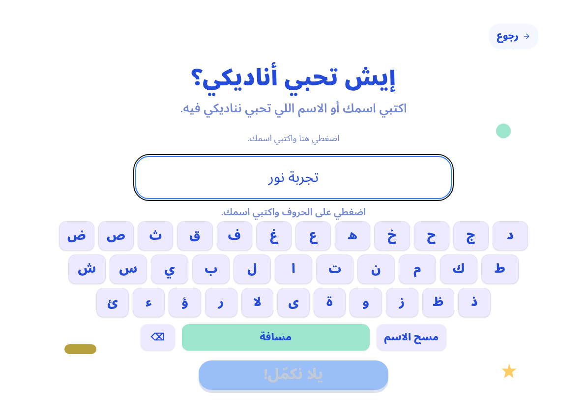
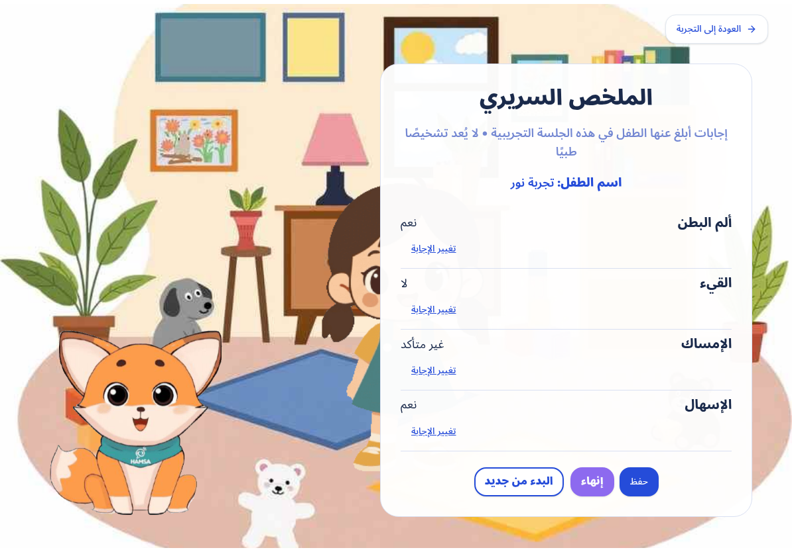

# HAMSA visual preview

Actual screenshots of the working MVP in this pull request, captured at
**1194 × 834** (11-inch iPad landscape dimensions). The names and answers shown
are fictional examples. These are screenshots, not a clickable live demo.

[Watch or download the recorded walkthrough](walkthrough.mp4?raw=true)

The walkthrough follows Welcome → language → avatar → name → room → symptom
animation → answers → thank you → clinical summary → save preview.

## Welcome

## Choose an avatar

## Interactive room

## Answer a symptom question

## Explore other symptoms

## Review the clinical summary

## Arabic keyboard

## Arabic clinical summary

To use the interactive application locally, check out this PR branch, run
`npm install` and `npm run dev`, then open the Local URL printed by Vite.
The app keeps the current child's responses in memory and clears them on reload.
